 

## Sobre mim

Desenvolvo sistemas web completos, do banco de dados à tela, para negócios que precisam de uma ferramenta feita para a sua rotina, e não de um software genérico adaptado.
Hoje meu foco está em PHP e MySQL, construindo soluções para pequenos negócios que precisam funcionar bem no balcão, no caixa e no dia a dia da equipe.
Também desenvolvo com React, Python e Django quando o projeto pede uma interface mais rica ou uma base diferente.
Em todo projeto, segurança e proteção de dados entram no planejamento, não no final.

 

## Tecnologias

<table align="center">
  <tr>
    <td align="center" width="200"><strong>Front-end</strong></td>
    <td align="center" width="200"><strong>Back-end</strong></td>
    <td align="center" width="200"><strong>Banco de dados</strong></td>
    <td align="center" width="200"><strong>Ferramentas</strong></td>
  </tr>
  <tr>
    <td align="center"></td>
    <td align="center"></td>
    <td align="center"></td>
    <td align="center"></td>
  </tr>
</table>

 

## Projetos

> O código destes sistemas é privado porque pertence aos clientes. Abaixo, o que cada um precisava e o que foi entregue.

<table>
  <tr>
    <td width="50%" valign="top">
      <h3>PDV de balcão para restaurante</h3>
      
<strong>O que o cliente precisava</strong> 
      Lançar pedidos rápido no horário de pico, mandar a comanda para a cozinha e fechar o dia sem confusão, com uma tela fácil para qualquer pessoa.

      
<strong>O que foi entregue</strong>

      <ul>
        <li>Balcão com botões grandes e impressão direta na térmica</li>
        <li>Perfis de acesso e cancelamento protegido por senha</li>
        <li>Cardápio administrável e pedidos do dia com faturamento</li>
        <li>Temas automáticos de datas comemorativas e versão para celular</li>
      </ul>
      
  

      <!--
      Espaço para prints do PDV (sem dados reais de clientes):
      
      -->
    </td>
    <td width="50%" valign="top">
      <h3>Gestão de relacionamento para campanha</h3>
      
<strong>O que o cliente precisava</strong> 
      Organizar contatos espalhados em planilhas, saber quem foi visitado e quando, e gerar listas para a equipe de rua.

      
<strong>O que foi entregue</strong>

      <ul>
        <li>Cadastro com endereço automático pelo CEP</li>
        <li>Histórico de interações e status do relacionamento</li>
        <li>Busca com filtros</li>
        <li>Exportação para Excel e listas para imprimir</li>
      </ul>
      
  

      <!--
      Espaço para prints do sistema de campanha (sem dados reais):
      
      -->
    </td>
  </tr>
</table>

 

## Como trabalho

1. **Entendo a rotina.** Antes de escrever código, acompanho como o negócio funciona no dia a dia.
2. **Construo e testo.** Cada funcionalidade é testada no cenário real de uso antes de chegar ao cliente.
3. **Entrego com segurança.** Controle de acesso, dados protegidos e LGPD fazem parte da primeira versão.
4. **Acompanho.** Sigo por perto na implantação e disponível para ajustes depois da entrega.

 

## Estatísticas

  
  

 

## Contato

&nbsp;

&nbsp;

&nbsp;

  

